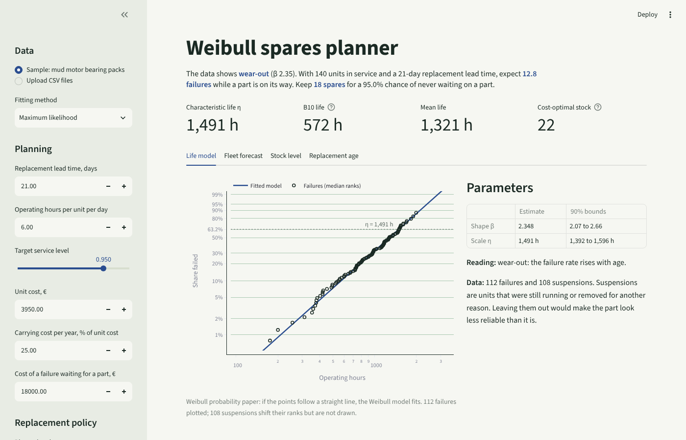
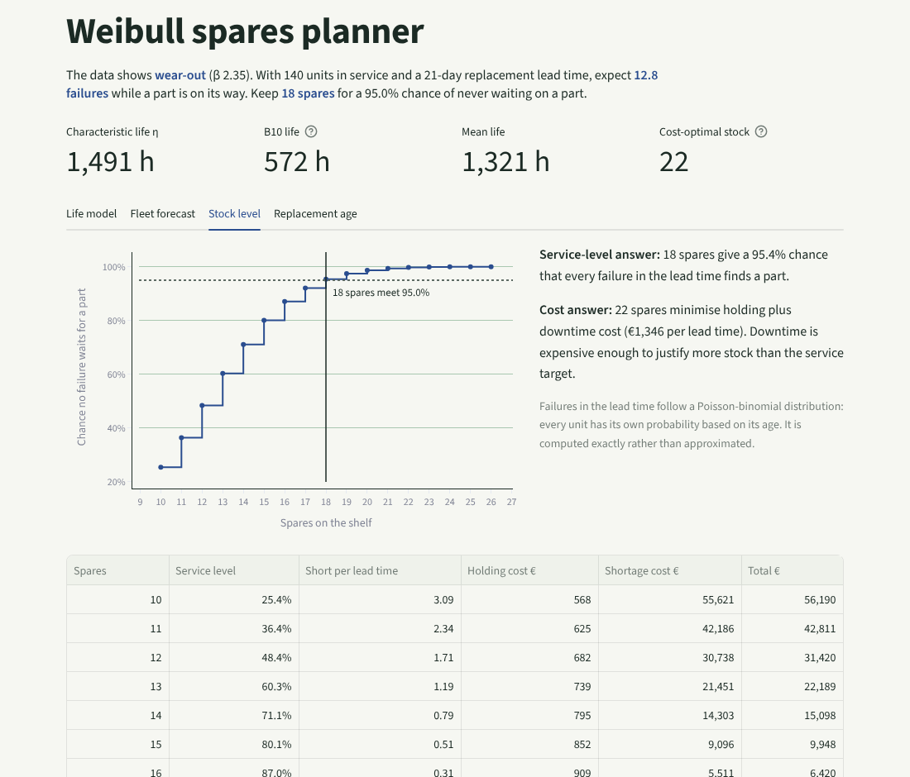

# Weibull spares planner

How many spare parts should a fleet keep, and when should parts be replaced before they fail? This project answers both from field data: it fits a Weibull life model to failure and suspension history, forecasts failures for the units installed today, and sizes spare stock by service level or by cost.



## Why I built it

In a manufacturing rotation I built a MATLAB lifetime analysis tool that modelled component life with a Weibull distribution and censoring, and fed it into a lifetime costing tool to improve cost forecasts for scrapped and non-scrapped parts. This is that idea rebuilt as a tested Python package, extended from "how long do parts live" to "how many spares do we need".

## What it does

**1. Fits a life model from real-world data.** Field data is mostly *suspensions*: units still running, or removed at a rebuild before they failed. Dropping them makes a part look worse than it is (the tests show estimates of life falling by more than 20%). Two methods are included:

- **Maximum likelihood** with right-censoring, solved through the profile likelihood (one equation in β, η in closed form), with 90% Fisher-matrix bounds. Verified against SciPy's independent censored fitter to within 0.01%.
- **Median-rank regression**, the method behind a classic Weibull plot, using Johnson's adjusted ranks and Bernard's approximation.

**2. Forecasts failures for the fleet you have.** Each installed unit has its own age, so its probability of failing in the next *n* hours is conditional on having survived so far. Old units carry most of the risk when a part wears out.

**3. Sizes spare stock.** Failures during the replacement lead time follow a **Poisson-binomial** distribution, one probability per unit. It is computed exactly by dynamic programming instead of the usual Poisson shortcut. From it:

- the **service-level stock**: the smallest stock with at least, say, a 95% chance that no failure waits for a part;
- the **cost-optimal stock**: minimum of carrying cost plus expected downtime cost.

**4. Simulates the next 12 months** by Monte Carlo with renewal (replaced units can fail again), which the exact lead-time calculation deliberately ignores.

**5. Finds the optimal preventive replacement age** using the age replacement policy, which minimises long-run cost per operating hour, compared with running to failure.

## Example (output shortened)

```text
$ weibull-spares plan data/bearing_pack_history.csv data/fleet.csv --lead-time-days 21
Fitted with maximum likelihood
  data             112 failures, 108 suspensions
  shape beta       2.35   (90% bounds 2.07 to 2.66)
  scale eta        1,491 h   (90% bounds 1,392 to 1,596 h)
  B10 life         572 h
  reading          wear-out: the failure rate rises with age

Fleet of 140 units, lead time 21 days (126 operating hours)
  expected failures in lead time   12.8
  stock for 95% service level      18
  cost-optimal stock               22  (99.7% service level)

Replace at 774 h: 10.68 per operating hour against 15.90 run-to-failure (33% lower).
```

The sample data is synthetic: bearing packs in a fleet of mud motors, generated from a known Weibull (β 2.4, η 1,450 h) by `scripts/make_sample_data.py`. The fit recovers both parameters within their bounds.



## Running it

```bash
python -m venv .venv && source .venv/bin/activate
pip install -e ".[app,dev]"

weibull-spares fit data/bearing_pack_history.csv
weibull-spares plan data/bearing_pack_history.csv data/fleet.csv --lead-time-days 21
streamlit run app/streamlit_app.py
pytest
```

The Streamlit app runs on [Streamlit Community Cloud](https://streamlit.io/cloud) as is: point it at this repository and `app/streamlit_app.py`.

### Input files

| File | Columns | Notes |
|---|---|---|
| Life history | `unit_id, hours, status` | `status` is `failed` or `suspended` |
| Installed fleet | `unit_id, age_hours` | current age of every unit in service |

Errors name the file, the row and the problem, for example `History file, row 3: hours must be a positive number, got -5`.

## Using it as a library

```python
from weibull_spares import fit_mle, lead_time_demand, stock_for_service_level

result = fit_mle(hours, failed)
demand = lead_time_demand(result.model, fleet_ages, horizon_hours=126)
spares = stock_for_service_level(demand, 0.95)
```

## Assumptions and limits

- Two-parameter Weibull. A failure-free period would need the three-parameter form.
- One failure mode per analysis. Mixed modes (for example seal leaks and bearing wear) should be separated first, or they show up as a kink on the probability plot.
- The lead-time calculation assumes a replacement does not fail again inside the same lead time. The app warns when that stops being safe, and the 12-month simulation covers it.
- Operating hours per day are a fleet average. Unit-level utilisation would sharpen the forecast.

## License

MIT
