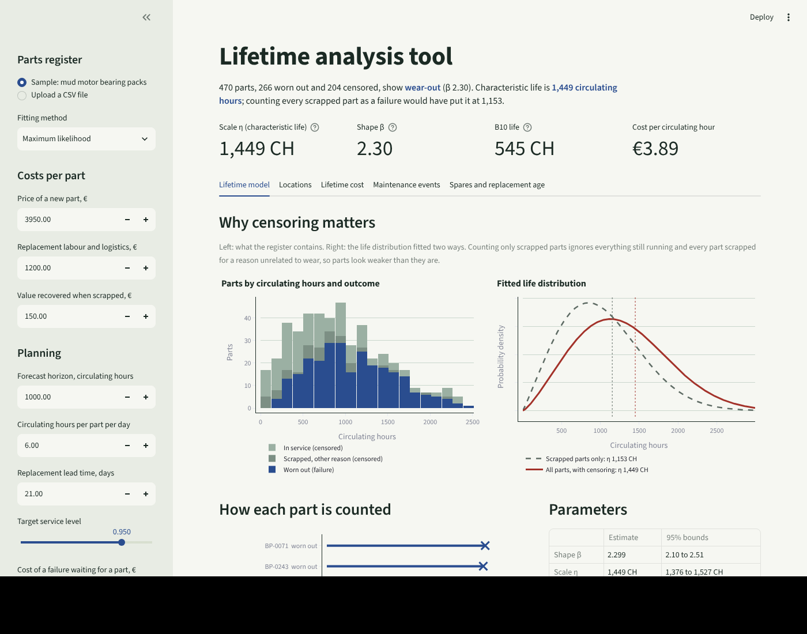
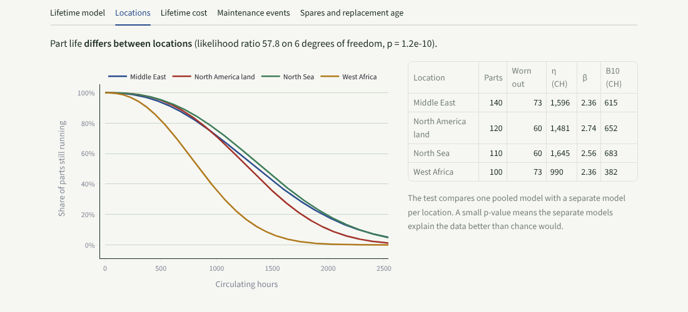
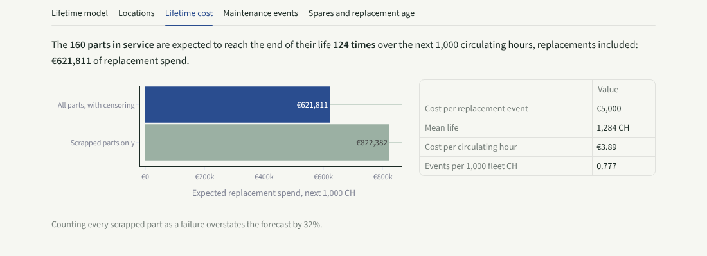

# Lifetime analysis tool

How long do parts really last, does it depend on where they run, and what will replacing them cost? This tool answers those questions from a **parts register**: every part's circulating hours, and whether and why it was scrapped. It fits a Weibull life model that handles censored data correctly, compares locations, turns the model into lifetime cost and maintenance-event forecasts, and sizes spare stock.



## Where this comes from

In a technical manufacturing rotation of a supply chain leadership programme I built a MATLAB lifetime analysis tool. It modelled the life of scrapped and non-scrapped parts in circulating hours with a Weibull distribution and maximum likelihood (`wblfit` with a censoring vector and 95% confidence), derived censoring from scrap reasons, compared failure trends between locations, and fed its statistics into a lifetime costing tool and into event-based maintenance planning.

This project rebuilds that tool in Python as a tested library, a command line and a web app, using the same conventions. **The sample data is synthetic**: one part number in four regions, generated from known Weibull parameters by `scripts/make_sample_data.py`.

> **Independent personal project.** I built this on my own time, after my employment ended, to show the kind of work I did professionally. It contains no code, data, documents, screenshots or other information belonging to any former employer, its customers or its suppliers. The method is rebuilt from general professional knowledge, all data in the repository is synthetic, and the only figures quoted from my career are the ones published on my CV.

## The key idea: censoring from scrap reasons

Most parts in a register have not worn out. Some are still in service; some were scrapped for reasons unrelated to wear. Both only tell us *the part lasted at least this long*. That is right-censored data, and it carries information.

| Scrap reason | Meaning | Censoring flag (MATLAB convention) |
|---|---|---|
| worn, washout, cracked, eroded … | the life ended | 0, fully observed |
| lost in hole, handling damage, obsolete revision … | removed for another reason | 1, right-censored |
| blank | still in service | 1, right-censored |

Unknown scrap reasons are reported, not guessed. A `censored` column with 0/1 flags can be supplied instead, exactly as for `wblfit`.

On the sample data the difference is large:

```text
$ weibull-spares fit data/parts_register.csv
Fitted with maximum likelihood
  data             266 worn out (failures), 204 censored
  shape beta       2.30   (95% bounds 2.10 to 2.51)
  scale eta        1,449 CH   (95% bounds 1,376 to 1,527 CH)
  B10 life         545 CH
  reading          wear-out: the failure rate rises with age

If every scrapped part counted as a failure and parts in service were ignored:
  scale eta        1,153 CH, shape beta 2.10
```

A reminder on naming, because it trips people up: **β is the shape** (below 1 early failures, around 1 random, above 1 wear-out) and **η is the scale** (the characteristic life, by which 63.2% of parts have worn out). MATLAB's `wblfit` returns them in the order `[scale shape]`.

## What it does

**1. Fits the life model.** Maximum likelihood with right-censoring, solved through the profile likelihood, with 95% Fisher-matrix bounds; verified against SciPy's independent censored fitter to within 0.01%. Median-rank regression (the classic Weibull plot) is available too.

**2. Compares locations.** One model per location, and a likelihood ratio test of separate models against one pooled model, so a harsher environment shows up as a real difference rather than a hunch from small samples.

```text
$ weibull-spares locations data/parts_register.csv
Location               parts  worn out   beta   eta (CH)   B10 (CH)
Middle East              140        73   2.36      1,596        615
North America land       120        60   2.74      1,481        652
North Sea                110        60   2.56      1,645        683
West Africa              100        73   2.36        990        382

Likelihood ratio test: 57.8 on 6 df, p = 1.24e-10. Part life differs between locations.
```



**3. Lifetime cost.** Cost per circulating hour (purchase plus replacement, less salvage, over the mean life) and the expected replacement spend for the parts in service over a horizon, with replacements that wear out again included by simulation. It also shows what the forecast would have been with the naive scrapped-only model: on the sample, **32% too high**.



**4. Maintenance events.** Expected end-of-life events per block of circulating hours, and the parts most likely to be next, which is the input event-based maintenance needs.

**5. Spares and replacement age.** The stock needed to cover the replacement lead time at a service level (exact Poisson-binomial over each part's own age) or at lowest cost, and the planned replacement age that minimises cost per circulating hour.

## Running it

```bash
python -m venv .venv && source .venv/bin/activate
pip install -e ".[app,dev]"

weibull-spares fit data/parts_register.csv
weibull-spares locations data/parts_register.csv
weibull-spares cost data/parts_register.csv --unit-cost 3950 --replacement-cost 1200 --salvage 150
weibull-spares spares data/parts_register.csv --lead-time-days 21

streamlit run app/streamlit_app.py
pytest
```

The Streamlit app runs on [Streamlit Community Cloud](https://streamlit.io/cloud) as is: point it at this repository and `app/streamlit_app.py`.

### Input

| Column | Notes |
|---|---|
| `part_id` | serial or part identifier |
| `part_number` | the app analyses one part number at a time |
| `location` | region, rig or site, for the location comparison |
| `circulating_hours` | hours accumulated at scrap, or so far if in service |
| `scrap_reason` | blank if in service; or use a `censored` column with 1/0 |

## Project structure

```
src/weibull_spares/data.py       parts register, scrap reasons to censoring
src/weibull_spares/weibull.py    model, maximum likelihood and rank regression fits
src/weibull_spares/locations.py  per-location fits and likelihood ratio test
src/weibull_spares/costing.py    lifetime cost and maintenance events
src/weibull_spares/forecast.py   lead-time demand and Monte Carlo with renewal
src/weibull_spares/stocking.py   spare stock and replacement age
app/streamlit_app.py             the web app
```

## Assumptions and limits

- Two-parameter Weibull. A failure-free period would need the three-parameter form.
- One failure mode per analysis. Mixed modes (for example seal wear and bearing wear) should be separated by scrap reason first.
- Circulating hours per part per day are a fleet average in the spares calculation.

## License

MIT
